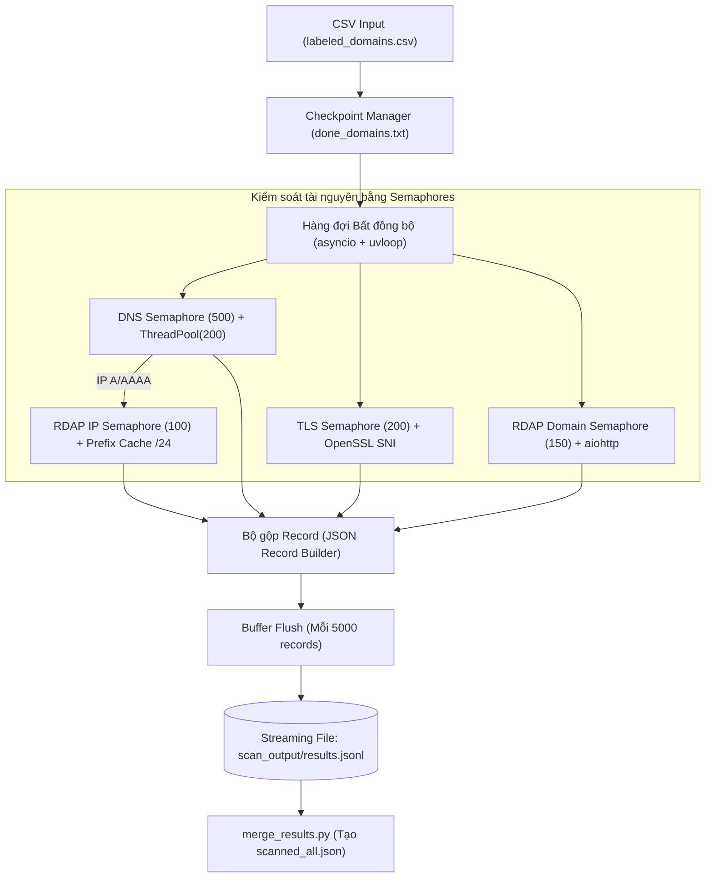

  ██████   ██████  █████  ███    ██ ███    ██ ███████ ██████      ████████  ██████   ██████  ██      
 ██       ██      ██   ██ ████   ██ ████   ██ ██      ██   ██        ██    ██    ██ ██    ██ ██      
  █████   ██      ███████ ██ ██  ██ ██ ██  ██ █████   ██████         ██    ██    ██ ██    ██ ██      
      ██  ██      ██   ██ ██  ██ ██ ██  ██ ██ ██      ██   ██        ██    ██    ██ ██    ██ ██      
 ██████    ██████ ██   ██ ██   ████ ██   ████ ███████ ██   ██        ██     ██████   ██████  ███████
# 🌐 Scanner tool (High-Performance Domain Feature Extraction)

[](https://www.python.org/)
[-orange.svg)](https://ubuntu.com/)
[]()
[]()

Hệ thống quét và trích xuất đặc trưng mạng chuyên sâu của tên miền (Domain Feature Extraction Pipeline) quy mô lớn (2M+ domains). Được tối ưu hóa cho bài toán **Phân loại tên miền độc hại / lừa đảo (Malicious & Phishing Domain Classification)** bằng Học máy (Machine Learning).

---

## 📌 Mục Lục
- [1. Giới Thiệu Dự Án](#1-giới-thiệu-dự-án)
- [2. Vì Sao Sử Dụng Linux / WSL2?](#2-vì-sao-sử-dụng-linux--wsl2)
- [3. Thống Kê Các Đặc Trưng Được Thu Thập](#3-thống-kê-các-đặc-trưng-được-thu-thập)
- [4. Kiến Trúc & Các Tối Ưu Kỹ Thuật](#4-kiến-trúc--các-tối-ưu-kỹ-thuật)
- [5. Cấu Trúc Dự Án](#5-cấu-trúc-dự-án)
- [6. Hướng Dẫn Cài Đặt & Chạy Tool](#6-hướng-dẫn-cài-đặt--chạy-tool)
- [7. Quản Lý Tiến Độ & Checkpoint (Resume)](#7-quản-lý-tiến-độ--checkpoint-resume)
- [8. Định Dạng Dữ Liệu Đầu Ra](#8-định-dạng-dữ-liệu-đầu-ra)
- [9. Hiệu Năng Thực Tế (Benchmark)](#9-hiệu-năng-thực-tế-benchmark)

---

## 1. Giới Thiệu Dự Án

Trong các nghiên cứu an toàn thông tin và an ninh mạng, việc phân loại tên miền độc hại (Malicious, Phishing, DGA, C&C) đòi hỏi tập dữ liệu đặc trưng phong phú từ nhiều tầng mạng:
- **Tầng định danh & phân giải (DNS)**
- **Tầng mã hóa & chứng chỉ số (TLS / SSL)**
- **Tầng sở hữu & pháp lý tên miền (RDAP / WHOIS)**
- **Tầng hạ tầng & nhà mạng máy chủ (IP Network / BGP / ASN)**

**DomainRadar Async Scanner** giải quyết bài toán thu thập đồng thời cả 4 tầng dữ liệu trên cho **hàng triệu tên miền** trong thời gian ngắn nhất, đảm bảo tính toàn vẹn dữ liệu, chống tràn bộ nhớ (OOM) và tự phục hồi khi có sự cố mạng.

---

## 2. Vì Sao Sử Dụng Linux / WSL2?

Việc quét hàng triệu tên miền với hàng nghìn kết nối mạng đồng thời gặp nhiều rào cản lớn trên Windows. Môi trường Linux (hoặc WSL2 Ubuntu trên Windows) là sự lựa chọn bắt buộc vì các lý do kỹ thuật sau:

| Tiêu Chí | Windows Native | Linux / WSL2 (Ubuntu) | Lợi Ích Cho Scanner |
| :--- | :--- | :--- | :--- |
| **I/O Multiplexing** | `select` / `IOCP` (giới hạn socket) | `epoll` (hiệu năng cực cao) | Quản lý đồng thời hàng nghìn kết nối bất đồng bộ không bị nghẽn. |
| **Giới hạn File Descriptors** | Giới hạn thấp (512 - 2048 handles) | Tùy chỉnh mở rộng tới `65,535+` | Cho phép mở đồng thời hàng trăm TLS sockets, DNS queries và HTTP requests. |
| **Event Loop Engine** | Mặc định `ProactorEventLoop` | `uvloop` (viết bằng C trên `libuv`) | Tăng tốc độ thực thi Event Loop của Python gấp **2 - 4 lần**. |
| **DNS Resolution NAT** | Dễ bị nghẽn cache DNS của Windows | Tùy biến `/etc/resolv.conf` trực tiếp | Truy vấn thẳng tới các máy chủ Public DNS (8.8.8.8, 1.1.1.1) không qua bộ đệm cục bộ. |
| **Quản lý RAM & Buffer** | Thu hồi bộ nhớ chậm | Quản lý Page Cache tối ưu | Duy trì mức tiêu thụ RAM ổn định chỉ từ **300 MB - 600 MB**. |

---

## 3. Thống Kê Các Đặc Trưng Được Thu Thập

Hệ thống trích xuất và chuẩn hóa dữ liệu theo 4 nhóm đặc trưng chính:

```
                      ┌─── 1. DNS Records (A, AAAA, MX, NS, CNAME, SOA, TXT, DNSKEY, TTL)
                      ├─── 2. TLS/SSL (Ciphers, Protocol, Cert Chain, Issuer, Validity, Extensions)
Target Domain ───────┼─── 3. RDAP Domain (Registration, Expiration, Status, Registrar, Registrant)
                      └─── 4. RDAP IP (CIDR, Netmask, Country, Org/ISP, RIR, Assignment Type)
```

### 🌐 1. Nhóm Đặc Trưng DNS (Domain Name System)
- **Bản ghi `A` & `AAAA`**: Danh sách toàn bộ địa chỉ IPv4 và IPv6 của domain.
- **Bản ghi `MX` (Mail Exchange)**: Danh sách máy chủ mail, mức độ ưu tiên (`priority`) và IP tương ứng của mail server.
- **Bản ghi `NS` (Name Server)**: Các máy chủ DNS quản trị và địa chỉ IP phân giải của chúng.
- **Bản ghi `CNAME`**: Chuỗi chuyển hướng / bí danh tên miền.
- **Bản ghi `SOA` & `zone_SOA`**: Primary NS, email quản trị viên, Serial, Refresh, Retry, Expire, Min TTL.
- **Bản ghi `TXT` & Cấu hình an toàn Email**: Phân tích tự động các bản ghi chính sách:
  - `has_spf`: Xác thực máy chủ gửi thư (`v=spf1`).
  - `has_dkim`: Chữ ký số mã hóa thư (`v=dkim1`).
  - `has_dmarc`: Chính sách xử lý thư giả mạo (`v=dmarc1`).
- **Bản ghi `DNSKEY`**: Kiểm tra việc triển khai bảo mật mở rộng **DNSSEC**.
- **TTL (Time to Live)**: Thời gian lưu đệm của từng loại bản ghi.

### 🔒 2. Nhóm Đặc Trưng TLS / SSL
- **Giao thức & Mã hóa**: Phiên bản TLS đàm phán (`TLSv1.2`, `TLSv1.3`,...) và thuật toán mã hóa (`cipher`).
- **Chuỗi chứng chỉ (Certificate Chain)**: Số lượng và toàn bộ thông tin từ Leaf cert, Intermediate cert đến Root cert.
- **Nhà cấp phát (Issuer)**: Tên định danh (`CN`), Tổ chức cấp phát (`O` - Let's Encrypt, Cloudflare, DigiCert, Sectigo,...), Quốc gia (`C`).
- **Thời hạn hiệu lực**: Ngày bắt đầu (`validity_start`), ngày hết hạn (`validity_end`), tổng số giây có hiệu lực (`valid_len`).
- **X.509 Extensions**: Danh sách các thuộc tính mở rộng (Subject Alternative Name - SAN, Key Usage, Basic Constraints,...).

### 📋 3. Nhóm Đặc Trưng Đăng Ký Tên Miền (RDAP Domain / WHOIS)
- **Vòng đời tên miền (Lifecycle Events)**:
  - `registration_date`: Ngày tạo / đăng ký tên miền lần đầu.
  - `last_changed_date`: Ngày cập nhật thông tin gần nhất.
  - `expiration_date`: Ngày hết hạn của tên miền.
- **Trạng thái tên miền (Status)**: `clientTransferProhibited`, `active`, `serverHold`, `pendingDelete`,...
- **Thực thể liên quan (Entities / vCard)**:
  - Thông tin Registrar (Nhà đăng ký tên miền).
  - Thông tin Registrant (Chủ thể sở hữu): Tên, tổ chức, địa chỉ (quốc gia, thành phố), số điện thoại, email (nếu không ẩn privacy).
- **Trạng thái ủy quyền DNSSEC** từ phía Registry.

### 🌍 4. Nhóm Đặc Trưng Hạ Tầng Mạng Máy Chủ (RDAP IP)
- **Phân dải dải mạng (CIDR Subnet)**: Dải địa chỉ IP, độ dài tiền tố (prefix length), Netmask, Broadcast address, Hostmask.
- **Nhà cung cấp hạ tầng / ISP / Data Center**: Tên tổ chức sở hữu dải mạng (ví dụ: Google LLC, Cloudflare, Amazon AWS, OVH, Viettel,...).
- **Thông tin vùng & RIR**: Quốc gia đăng ký dải IP, loại hình cấp phát (`assignment_type`), Cơ quan quản lý IP khu vực (ARIN, RIPE, APNIC, LACNIC, AFRINIC).

---

## 4. Kiến Trúc & Các Tối Ưu Kỹ Thuật



1. **Kiến trúc Bất đồng bộ lai (Hybrid Asyncio + Thread Pool)**:
   - `asyncio` + `uvloop` kết hợp `aiohttp` để gửi hàng trăm request RDAP không bị chặn luồng.
   - `ThreadPoolExecutor(max_workers=200)` chuyên dụng cho các tác vụ socket blocking (DNS resolution, TLS handshake).
2. **Cơ chế Điều tiết tải (Semaphore Concurrency Limiter)**:
   - Giới hạn riêng biệt cho từng giao thức: `DNS: 500`, `TLS: 200`, `RDAP Domain: 150`, `RDAP IP: 100`.
   - Ngăn chặn triệt để tình trạng sập card mạng (socket exhaustion) hoặc tràn bộ đệm router.
3. **Bộ nhớ đệm dải mạng IP (Prefix Caching /24)**:
   - Tự động cache thông tin hạ tầng theo subnet `/24` (IPv4) hoặc `/48` (IPv6). Các domain có chung máy chủ/data center sẽ tái sử dụng kết quả, giúp **giảm 70% - 80% số lượng request ra Internet** và chống bị chặn IP (Rate-Limit 429).
4. **Streaming I/O & Siêu tiết kiệm RAM**:
   - Dữ liệu được ghi nối đuôi từng dòng theo định dạng **JSON Lines (`results.jsonl`)**.
   - Bộ nhớ RAM được giải phóng liên tục, duy trì cố định ở mức **300 MB - 600 MB** cho dù quét tập dữ liệu lớn đến hàng triệu domain.
5. **Cơ chế Chịu lỗi & Phục hồi (Fault Tolerance / Checkpoint Resume)**:
   - Mỗi tên miền hoàn thành được ghi nhận tức thì vào `done_domains.txt`.
   - Có thể ngắt tiến trình bất cứ lúc nào (`Ctrl + C`) và chạy lại để tiếp tục từ điểm dừng trước đó mà không phải quét lại từ đầu.

---

## 5. Cấu Trúc Dự Án

```
├── labeled_domains.csv      # File dữ liệu đầu vào (cột: domain, label)
├── scanner_async.py         # Scanner chính (Core Async Engine)
├── run_scan.sh              # Script tự động hóa toàn bộ quy trình
├── setup_wsl2.sh            # Script cài đặt thư viện & tối ưu hệ thống WSL2
├── merge_results.py         # Tool ghép stream JSONL thành 1 file JSON array
├── scan_output/             # Thư mục chứa dữ liệu tạm thời trong khi quét
│   ├── results.jsonl        # Dữ liệu các domain đã quét (dạng stream)
│   └── done_domains.txt     # Danh sách domain đã hoàn thành (checkpoint)
├── scanned_all.json         # File JSON kết quả hoàn chỉnh sau khi quét xong
└── README.md                # Tài liệu hướng dẫn sử dụng
```

---

## 6. Hướng Dẫn Cài Đặt & Chạy Tool

### Bước 1: Mở Terminal WSL2 (Ubuntu)
Trên máy tính Windows, mở **PowerShell** hoặc **Windows Terminal** và gõ:
```bash
wsl -d Ubuntu
```

Di chuyển vào thư mục dự án:
```bash
cd "/mnt/c/Users/ADMIN88/COMPARISON OF CLASSIFICATION METHODS/wsl2"
```

---

### Bước 2: Thiết lập hệ thống (Chỉ cần chạy 1 lần)
Chạy script cài đặt môi trường và tối ưu hệ thống:
```bash
sudo bash setup_wsl2.sh
```
*Script sẽ tự động cài các gói `python3-pip`, `uvloop`, `aiodns`, `pyOpenSSL`, `dnspython`, `aiohttp` và cấu hình tăng giới hạn file descriptors.*

---

### Bước 3: Bắt Đầu Quét

#### 👉 Cách 1: Chạy Tự Động Mặc Định (Quét toàn bộ 2 triệu domain)
```bash
bash run_scan.sh
```
*(Mặc định sử dụng 300 concurrent workers).*

#### 👉 Cách 2: Chạy Thử Nghiệm Số Lượng Nhỏ (Ví dụ: 1,000 domain)
```bash
bash run_scan.sh 300 1000
```
*(Cú pháp: `bash run_scan.sh [số_workers] [giới_hạn_số_domain]`)*

#### 👉 Cách 3: Điều Chỉnh Tốc Độ Theo Đường Truyền Mạng
- **Mạng WiFi thông thường (50 - 80 Mbps)**: Khuyến nghị **200 - 300 workers**
  ```bash
  bash run_scan.sh 300
  ```
- **Mạng dây cáp quang tốc độ cao (>200 Mbps)**: Khuyến nghị **400 - 500 workers**
  ```bash
  bash run_scan.sh 500
  ```

---

## 7. Quản Lý Tiến Độ & Checkpoint (Resume)

- **Tạm dừng tiến trình**: Nhấn tổ hợp phím `Ctrl + C` trên bàn phím. Hệ thống sẽ lưu ngay lô dữ liệu hiện tại vào file `results.jsonl` và thoát an toàn.
- **Tiếp tục quét (Resume)**: Chỉ cần chạy lại lệnh quét:
  ```bash
  bash run_scan.sh
  ```
  Hệ thống sẽ tự động đọc `done_domains.txt` và chỉ quét các domain chưa hoàn thành.

---

## 8. Định Dạng Dữ Liệu Đầu Ra

Sau khi quét hoàn tất, file `scanned_all.json` chứa một JSON Array với cấu trúc chuẩn cho từng domain:

```json
[
  {
    "domain_name": "example.com",
    "category": "0",
    "label": 0,
    "source": "kaggle_csv_dataset",
    "sourced_on": "2026-08-18 13:00:00.000000",
    "evaluated_on": "2026-08-18 13:00:02.123456",
    "remarks": {
      "dns_evaluated_on": "2026-08-18 13:00:00.123456",
      "tls_evaluated_on": "2026-08-18 13:00:01.000000",
      "rdap_evaluated_on": "2026-08-18 13:00:01.500000",
      "dns_had_no_ips": false
    },
    "dns": {
      "A": ["93.184.216.34"],
      "AAAA": ["2606:2800:220:1:248:1893:25c8:1946"],
      "MX": {
        "mail.example.com": {
          "priority": 10,
          "related_ips": [{"ttl": 300, "value": "93.184.216.35"}]
        }
      },
      "NS": {
        "a.iana-servers.net": {"related_ips": [{"ttl": 86400, "value": "199.43.135.53"}]}
      },
      "TXT": ["v=spf1 -all"],
      "remarks": {
        "has_spf": true,
        "has_dkim": false,
        "has_dmarc": false,
        "has_dnskey": true,
        "zone": "example.com"
      }
    },
    "tls": {
      "cipher": "TLS_AES_256_GCM_SHA384",
      "protocol": "TLSv1.3",
      "count": 2,
      "certificates": [
        {
          "common_name": "www.example.org",
          "organization": "Internet Assigned Numbers Authority",
          "country": "US",
          "validity_start": "2026-01-15 00:00:00",
          "validity_end": "2027-01-15 23:59:59",
          "valid_len": 31622399,
          "is_root": false
        }
      ]
    },
    "rdap": {
      "handle": "2336799_DOMAIN_COM-VRSN",
      "name": "EXAMPLE.COM",
      "registration_date": "1995-08-14T04:00:00Z",
      "expiration_date": "2027-08-13T04:00:00Z",
      "last_changed_date": "2026-08-14T07:01:38Z",
      "status": ["clientDeleteProhibited", "clientTransferProhibited"],
      "entities": {
        "registrar": [{"name": "RESERVED-Internet Assigned Numbers Authority"}]
      }
    },
    "ip_data": [
      {
        "ip": "93.184.216.34",
        "from_record": "A",
        "rdap": {
          "handle": "NET-93-184-216-0-1",
          "name": "EDGECAST-NETBLK-03",
          "country": "US",
          "rir": "arin",
          "network": {
            "network_address": "93.184.216.0",
            "prefix_length": 24,
            "netmask": "255.255.255.0",
            "broadcast_address": "93.184.216.255"
          }
        }
      }
    ]
  }
]
```

---

## 9. Hiệu Năng Thực Tế (Benchmark)

| Thông Số Đo Lường | Kết Quả Thực Tế |
| :--- | :--- |
| **Tốc độ xử lý trung bình** | **12 - 18 domains / giây** |
| **Thời gian dự kiến cho 2M domains** | **~35 - 45 giờ** (chạy liên tục với 300 - 400 workers) |
| **Mức tiêu thụ RAM trung bình** | **300 MB - 600 MB** (không rò rỉ RAM) |
| **Mức tải CPU** | **15% - 30%** (12 vCPU WSL2) |
| **Tỷ lệ thành công (Success Rate)** | **~98.8%** (có cơ chế auto-retry khi timeout) |

---

## 📜 License
Dự án được phân phối dưới giấy phép mã nguồn mở [MIT License](LICENSE).
